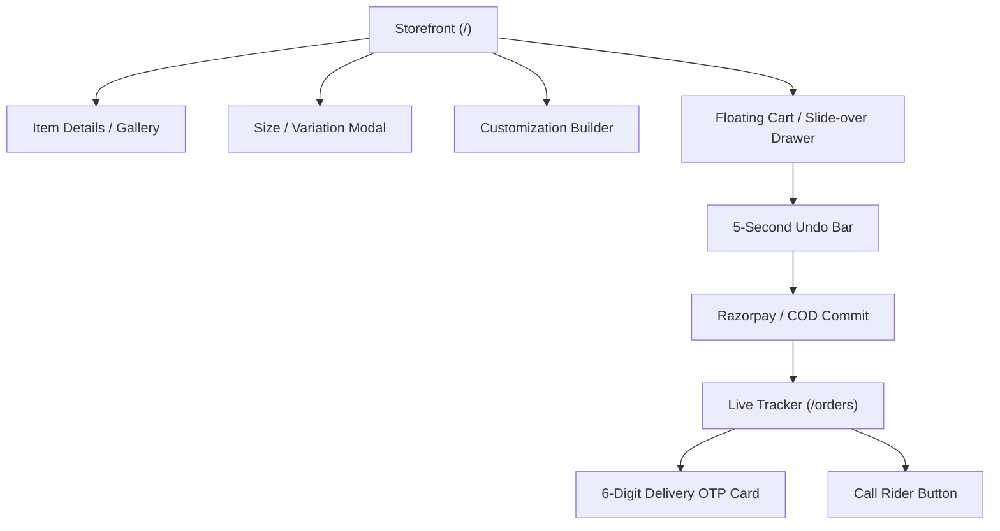
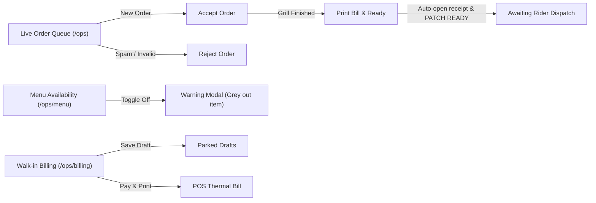
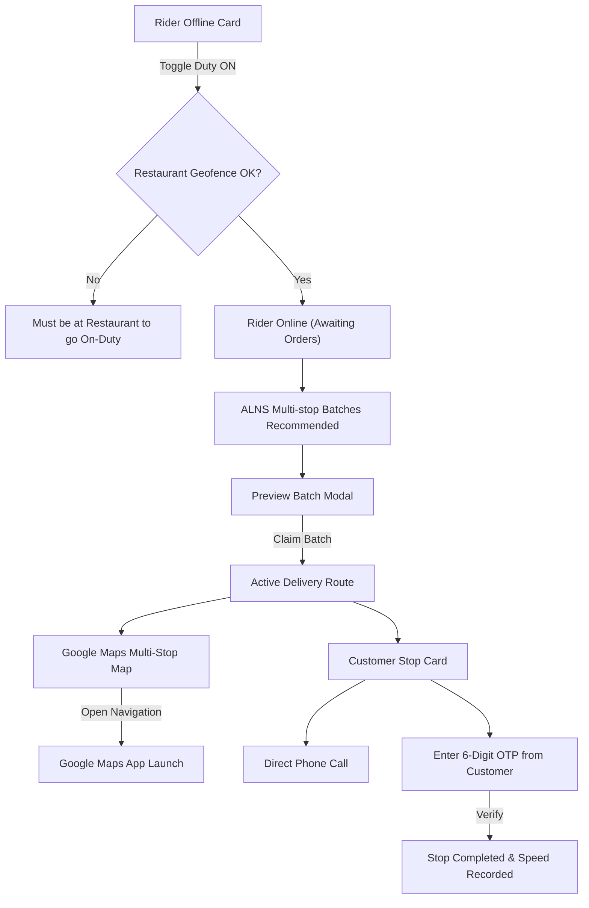

# KebabZilla Frontend Architecture & UI/UX Specification

This comprehensive blueprint details every screen, element, button, modal, navigation flow, and dynamic event state across all **4 access levels** of the KebabZilla platform. It is structured specifically to serve as a design prompt and system specification for generating Android application designs (Material 3 / Jetpack Compose / Flutter).

---

## 1. Global Shell & Navigation Architecture

### 1.1 Top App Bar (`AppHeader`)
* **Location:** Fixed at the top across all pages.
* **Elements:**
  * **Brand Logo & Name (`Brand`):** Left-aligned.
    * *Action:* Clicking navigates to `/` (Storefront for Customers) or home workspace for authenticated roles.
  * **Workspace Navigation Center (Desktop/Tablet):** Center-aligned dynamic tab bar with horizontal smooth drag/scroll and chevron scroll arrows (`<` / `>`) when overflowing.
  * **Workspace Drawer Trigger (`MenuIcon`):** Visible on mobile/narrow viewports for Staff, Rider, and Admin.
    * *Action:* Opens the slide-over Workspace Navigation Drawer from the left.
  * **Account Controls (Right Side):**
    * *Guest State:*
      * **"Sign in" Button:** Ghost pill with `LogIn` icon. Opens `/login`.
      * **"Sign up" Button:** Primary accent pill with `Plus` icon. Opens `/register`.
    * *Authenticated State:*
      * **User Avatar Chip:** Circular avatar with the first letter of user's name, first name, and a colored dot indicating the active role (Customer = Slate, Staff = Amber, Rider = Emerald, Admin = Crimson).
      * *Action:* Tapping toggles the **Profile Dropdown Menu**.
      * **"Sign out" Icon Button:** Door/LogOut icon. Clears JWT token session and redirects to `/`.

### 1.2 Profile Dropdown Menu
* **Trigger:** Tapping the User Avatar Chip in the Top App Bar.
* **Items (Filtered by Role):**
  1. **"Track orders":** Clipboard icon $\rightarrow$ Navigates to `/orders`.
  2. **"Deliveries"** *(Rider only)*: PackageCheck icon $\rightarrow$ Navigates to `/delivery`.
  3. **"Order queue"** *(Staff only)*: CookingPot icon $\rightarrow$ Navigates to `/ops`.
  4. **"Admin overview"** *(Admin only)*: LayoutDashboard icon $\rightarrow$ Navigates to `/admin`.
  5. **"Edit profile":** Users icon $\rightarrow$ Navigates to `/profile`.
  6. **"Security"** *(Staff, Rider, Admin only)*: Shield icon $\rightarrow$ Navigates to `/security`.

### 1.3 Mobile Workspace Navigation Drawer (Staff / Rider / Admin)
* **Trigger:** Hamburger icon in the Top App Bar.
* **Container:** 320dp slide-over drawer from the left with dark backdrop blur.
* **Elements:**
  * **Header:** Role kicker (e.g. `STAFF WORKSPACE`), "Navigation" title, and Close `(X)` button.
  * **"Quick access" Accordion (Collapsible):** Allows pinning favorite operational tabs to the persistent top navigation bar.
  * **Nav List:** Full list of role-specific navigation tiles with active highlight indicators.

### 1.4 Global Footer (`app-footer`)
* **Location:** Persistent bottom of all customer-facing views.
* **Elements:**
  * **Brand & Copyright:** Logo, year, and legal rights.
  * **Legal Policy Modals:** Text buttons for `Privacy Policy`, `Data Policy`, and `Cookie Policy` (each opens an in-app center modal dialog).
  * **Contact & Location:**
    * Email link (`mailto:...`) with Mail icon.
    * Clickable telephone numbers (`tel:...`) with Phone icon.
    * Physical restaurant address with MapPin icon $\rightarrow$ Tapping launches Google Maps at the restaurant's coordinates.

---

## 2. Level 1: Customer / User Access (`USER` & Guest)



### 2.1 Storefront Screen (`/`)
#### Header Hero & Operational Banner
* **Banner Status Ticker:**
  * *Normal Open:* Displays restaurant name, tagline ("KebabZilla — Taste that roars"), cuisine tags, and operating hours.
  * *Closing Soon (<30 mins to cutoff):* Banner shifts to warm amber gradient with message `"Hurry up closing soon"` and a dynamic minute countdown badge updating every 30 seconds.
  * *Delivery Cutoff Reached:* Title changes to `"Delivery is currently unavailable"`, subtitle clarifies `"Walk-in only"`.
  * *Store Closed:* Banner displays `"Sorry, we are closed"` and subtitle `"Our shop is currently closed. Please check back during operating hours."`

#### Search & Category Filtering Bar
* **Category Pills (Horizontal Scrollable Strip):**
  * Pills: `All`, `Kebabs`, `Rolls`, `Platters`, `Sides`, `Beverages`.
  * *State:* Active category has solid dark background with light text; inactive pills have muted border and transparent background.
* **Search Input:** Search magnifying glass icon with placeholder `"Search menu items..."` and an `(X)` clear button that appears when typing.
* **Sort Dropdown:** Pill selector containing:
  * `Most Popular` (default)
  * `Price: Low to High`
  * `Price: High to Low`

#### Food Grid & Item Cards
* **Card Anatomy:**
  * **Image Container:** High-resolution photography thumbnail with smooth corner radii.
    * *Badges Overlay:* Top-left shows `Veg` (green dot) / `Non-Veg` (red triangle) and optional `Featured` / `Bestseller` / `Spicy` flame icon.
  * **Title & Description:** Bold item name, 2-line truncated description.
  * **Price Display:** Displays lowest base price in Indian Rupees (e.g. `₹180`). If discounted, displays original price with strikethrough next to the bold discount price.
  * **Action Button (Bottom-Right of Card):**
    * *Standard Simple Item:* Displays `+ Add` button.
      * *Action:* Clicking immediately adds 1 quantity and **morphs the button into a stepper**: `[-]` `[ 1 ]` `[+]`.
    * *Item with Variations (e.g., Half / Full / 4 pcs / 8 pcs):* Displays `+ Choose size` button.
      * *Action:* Opens the **Size & Variation Modal**.
    * *Customizable Item (e.g., custom shawarma roll with dips/toppings):* Displays `+ Customise` button.
      * *Action:* Opens the **Customization Modal**.
    * *Re-adding a Custom Item:* If the item is already in the cart, pressing `+` triggers the **"Repeat Last Customization?" Prompt Modal**.
    * *Item Paused / Out of Stock:* Button is replaced by a static grey pill: `<span class="closed-menu-label">Currently unavailable</span>`.
    * *Store Closed:* Button is replaced by `<span class="closed-menu-label">Closed</span>`.
    * *Delivery Paused:* Button is replaced by `<span class="closed-menu-label">Walk-in only</span>`.

### 2.2 Customer Modals

#### A. Item Detail Modal
* **Trigger:** Tapping anywhere on a food card's image or body.
* **Elements:**
  * Full-width multi-image gallery carousel with prev/next navigation arrows and indicator dots.
  * Full ingredients and allergen description.
  * Dietary tags (Vegetarian/Halal/Spicy).
  * Quantity picker and large primary CTA button `"Add to Cart · ₹XXX"`.

#### B. Size & Variation Modal
* **Trigger:** Tapping `+ Choose size` on a variation-enabled card.
* **Elements:**
  * Title: `"Choose option for [Item Name]"`.
  * Radio options list (e.g., `4 Pieces - ₹140`, `8 Pieces - ₹260`).
  * Quantity stepper `[-] [ 1 ] [+]`.
  * Dynamic live total calculation at the bottom.
  * CTA Button: `"Add item · ₹XXX"`.

#### C. Customization Builder Modal
* **Trigger:** Tapping `+ Customise`.
* **Elements:**
  * Sectioned step-by-step or accordion groups:
    * *Single Choice (Radio):* e.g., Choice of Bread / Base (Rumali Roti, Paratha, Rice Bowl).
    * *Multiple Choice (Checkboxes):* Extra Toppings / Sauces (Garlic Mayo +₹20, Extra Cheese +₹30, Jalapeños +₹15).
  * Mandatory indicator (`Required` badge) disabling the CTA button until valid.
  * Fixed footer with live price tally and CTA button: `"Add to Order · ₹XXX"`.

#### D. Repeat Customization Prompt Modal
* **Trigger:** Tapping `+` on an already customized item in the cart.
* **Elements:**
  * Title: `"Repeat customisation?"`
  * Summary of the previous custom options selected.
  * Two buttons:
    * `I'll choose again` (Secondary): Clears previous choices and opens fresh Customization Modal.
    * `Repeat last` (Primary Accent): Immediately increments the quantity with the exact same ingredient selections.

### 2.3 Floating Cart Bar & Slide-Over Checkout Drawer

#### Floating Cart Dock (LiquidGlass Bottom Bar)
* **Trigger:** Appears at the bottom of the viewport as soon as `totalItems > 0`.
* **Elements:**
  * Left: Shopping bag icon + item count badge (`"2 items"`).
  * Center: Total amount (`"₹380"`).
  * Right: `"View cart"` button with an `ArrowRight` icon.
  * *Action:* Clicking slides open the **Cart Drawer** from the right (or bottom sheet on mobile).

#### Cart Drawer / Slide-Over Sheet
* **Elements & Sections:**
  1. **Header:** `"Your Cart"` title with item count and close `(X)` icon button.
  2. **Cart Items List:**
     * Thumbnail, name, chosen variation/custom options breakdown.
     * Line price.
     * Stepper control `[-] [qty] [+]`. Reducing quantity to 0 removes the item.
  3. **Delivery Address Selector:**
     * Chips for saved addresses (`Home`, `Work`).
     * `+ Add new address` button $\rightarrow$ Opens the **Address Geocoding Map Modal**.
     * Real-time delivery distance calculation badge (e.g. `"3.2 km away · ₹30 delivery"` or `"Free delivery within 2.0 km"`).
     * If outside radius: Warning banner `"Address is outside our 15 km delivery radius"`.
  4. **Cooking & Delivery Instructions:** Textarea input with placeholder `"e.g. Leave with security, extra green chutney"`.
  5. **Order Schedule (Optional):** Time picker dropdown for same-day scheduled delivery in 15-minute intervals.
  6. **Payment Method Selector:**
     * Radio Button 1: `Online Payment (UPI, Cards, NetBanking via Razorpay)`
     * Radio Button 2: `Cash on Delivery (COD)`
  7. **Bill Breakdown Table:**
     * Item Total: `₹XXX`
     * Delivery Fee: `₹XX` (or `FREE`)
     * Round Off: `₹X`
     * **Grand Total: `₹XXX`** (in large bold font)
  8. **Checkout Action CTA Button:**
     * *Normal State:* `"Pay ₹XXX"` or `"Place Cash Order"`.
     * *Cancellation Grace Period:* Tapping triggers a **5-second undo timer**. The button morphs into a green bar with an animated progress bar fill (`.checkout-loading-bar`) reading `"Hold to cancel (5s)"`. Tapping cancels checkout; letting it complete launches payment.
     * *Disabled State (Store Closed / Delivery Paused):* Greyed out with label `"Store is currently closed"`.

### 2.4 Live Order Tracking Screen (`/orders`)
* **Access:** Requires login or order token.
* **Top Bar:** Page title `"My orders"` with a manual `"Refresh"` button (`RefreshCw` icon).
* **Order Card Components:**
  * **Card Header:** Order placed timestamp, Order ID (e.g. `#1042`), and dynamic `StatusBadge`.
  * **5-Stage Visual Progress Tracker:**
    1. `Order received` (`PLACED`)
    2. `Accepted & preparing` (`ACCEPTED` / `PREPARING`)
    3. `Ready for delivery` (`READY`)
    4. `Out for delivery` (`OUT_FOR_DELIVERY`)
    5. `Delivered` (`DELIVERED`)
  * **Items Summary:** Thumbnail carousel, item quantities, names, line totals, and final bill.
  * **Active Driver Card (Visible when `OUT_FOR_DELIVERY`):**
    * Rider name and icon.
    * `"Call [Rider Name]"` button (`tel:...` direct phone link).
  * **6-Digit Customer Delivery OTP Highlight Box:**
    * Prominent emerald bordered card containing:
      * ShieldCheck icon.
      * Label: `"YOUR DELIVERY CODE"`.
      * Large bold 6-digit number (e.g. `482 910`).
      * Instruction: `"Share this code with your delivery partner upon arrival."`
  * **Footer Action Buttons:**
    * If status is `PLACED`: `"Cancel order"` button (initiates automated Razorpay refund if paid online).
    * If status is `ACCEPTED` / `PREPARING`: Cancel button disappears and is replaced by notice: `"Order in prep. Call restaurant to cancel: [Phone Link]"`.
    * If status is unpaid Razorpay: `"Pay online"` button (re-opens Razorpay modal).
    * If status is `DELIVERED`: `"Order again ->"` button (redirects to Storefront).

### 2.5 Profile & Address Book (`/profile`)
* **Personal Information:** Edit name and Indian mobile number (`+91...`) with validation.
* **Saved Addresses Section:**
  * List of saved cards with label (`Home`, `Work`, `Other`), full formatted address, and a `Default` star badge.
  * Actions per address: `Edit` button, `Delete` trash icon button.
  * **`+ Add New Address` Button:** Opens the **Google Maps Geocoding Pin Modal**:
    * Map centered on restaurant with draggable pin.
    * `"Use my current GPS location"` target icon button.
    * Real-time distance-to-restaurant calculation tag showing whether point is within the 15km delivery polygon.
    * House / Flat number and landmark text inputs.
    * `"Save address"` primary button.

---

## 3. Level 2: Kitchen & Operations Staff Access (`EMPLOYEE` / `STAFF`)



### 3.1 Kitchen Live Order Queue (`/ops`)
* **Header Bar:** Eyebrow `"THE GRILL IS ON"`, title `"Order queue"`, and an animated green pulsing indicator (`"Live queue"`).
* **Top Metric Counter Cards (4 KPIs):**
  1. *New orders:* Orange card with `ClipboardList` icon showing pending unaccepted count.
  2. *On the grill:* Amber card with `CookingPot` icon showing active prep count.
  3. *Ready to go:* Green card with `Truck` icon showing kitchen-completed orders awaiting rider pickup.
  4. *Orders today:* Plum card with `CircleCheck` icon showing total orders completed today.
* **Filter Tabs:**
  * `Active` (default: shows `PLACED`, `ACCEPTED`, `PREPARING`, `READY`).
  * `New` (shows count badge of unaccepted orders).
  * `Ready` (shows items waiting on the counter).
* **Kitchen Order Ticket Cards:**
  * **Ticket Head:** Timestamp, large bold persistent **Order ID (`Order #1042`)**, and `StatusBadge`.
  * **Customer Info Row:** Customer name, phone, and badge indicating `ONLINE ORDER` (amber) or `WALK-IN` (slate).
  * **Items List:** Quantities in bold, item names, custom modifications (e.g. `1x Rumali Shawarma (+Garlic Mayo, No Onions)`), and prices.
  * **Order Type & Logistics:** Shows whether order is `Delivery order`, `Restaurant counter pickup`, or `Walk-in dine-in`.
  * **Ticket Action Buttons (Dynamic based on state):**
    * *If `PLACED`:*
      * `Reject` (Ghost button with red hover text) $\rightarrow$ Cancels order and notifies customer.
      * `Accept` (Primary dark button with Check icon) $\rightarrow$ Advances order to `ACCEPTED`/`PREPARING`.
    * *If `ACCEPTED` or `PREPARING`:*
      * `Print bill & ready` (Primary button with `ReceiptText` icon) $\rightarrow$ Launches browser thermal print dialog formatted for 80mm/58mm receipt printers AND automatically advances status to `READY`.
    * *If `READY`:*
      * Static badge: `"Waiting for delivery partner"` (Waiting for Rider to claim batch).

### 3.2 Menu Availability Management (`/ops/menu`)
* **Header:** Title `"Menu availability"` and subtitle `"Turn an item off until the next working day, then turn it back on any time."`
* **Search Input:** Full-width search bar filtering items by name, category, or ingredients.
* **Item Row Anatomy:**
  * Item name, category badge (`Specialty Rolls`, `Kebabs`), custom/variation indicators, base price.
  * Subtext status:
    * Available: `"Available to order"`.
    * Paused: `"Off until the next working day · paused by [Staff Name]"`.
  * **Toggle Switch:**
    * *Turning Off:* Intercepted by a **Menu Availability Warning Dialog**:
      * Tone: Warning (Amber).
      * Title: `"Turn off [Item Name]?"`.
      * Description: `"Are you sure you want to turn off [Item Name]? This will grey out the item on the customer menu and mark it as currently unavailable until the next working day."`
      * Actions: `Keep available` (Cancel) vs `Turn off menu item` (Danger red button).
    * *Turning On:* Immediately restores the item and removes the desaturation on customer devices in real time.

### 3.3 Walk-in Billing Register (`/ops/billing`)
* **Tabs:** `New Bill` vs `Past Bills`.
* **New Bill POS Screen:**
  * **Left Pane (Menu Picker):** Item catalog with instant category tabs and search bar. Clicking `+ Add` pushes item into the active counter ticket.
  * **Right Pane (Order Ticket & Settlement):**
    * Customer Name & Phone number input (with Indian `+91` validation).
    * Dine-in vs Takeaway toggle chips.
    * Live line items table with quantity adjustments.
    * Subtotal, tax, and automatic round-off calculation.
    * **Action Buttons:**
      * `Hold order as draft` (Secondary button with Save icon): Parks current ticket in local drafts memory; increments the Drafts Counter Badge.
      * `Parked Drafts` button: Opens modal of saved tickets to resume or delete.
      * `Pay & generate bill` (Primary emerald button): Records counter cash/UPI payment, clears the screen, and launches the thermal print popup.
* **Past Bills Screen:**
  * Searchable and sortable log of all counter receipts with `Re-print receipt` buttons.

---

## 4. Level 3: Delivery Rider Access (`DELIVERY` / `RIDER`)



### 4.1 Duty Status Card
* **Location:** Top of `/delivery` (visible when rider has 0 active deliveries).
* **Elements:**
  * Power icon badge (`Emerald` when active, `Slate` when offline).
  * Status text: `"You are on duty · accepting orders"` vs `"You are offline · not receiving orders"`.
  * **Duty Toggle Switch (`Power`):**
    * *Attempting to go On-Duty when Store is Closed:* Blocks toggle and displays error notice: `"Cannot accept deliveries outside restaurant operating hours."`
    * *Geofence Enforcement:* If enabled in settings, checks rider's current device GPS against the restaurant's coordinates. If rider is further than allowed meters, alerts: `"GPS verification required: You must be at the restaurant to accept deliveries."`

### 4.2 Recommended Batches (ALNS Clustering)
* **Trigger:** Rider is on-duty and unassigned orders are ready at the kitchen pass.
* **Display Format:** Recommended Multi-Stop Batch Cards generated by the Adaptive Large Neighborhood Search (ALNS) algorithm.
* **Batch Card Anatomy:**
  * Header: `"RECOMMENDED BATCH"` badge with stop count (e.g. `2 Orders · Optimized Route`).
  * Total route distance (e.g. `5.4 km`) and estimated travel time.
  * Stop breakdown list: Stop 1 Customer Name & Address $\rightarrow$ Stop 2 Customer Name & Address.
  * **Buttons:**
    * `Preview Batch Route` button $\rightarrow$ Opens modal with visual map and waypoint markers.
    * `Claim Batch` (Primary green CTA) $\rightarrow$ Locks all orders in the cluster to this rider and switches screen into **Active Route Mode**.
  * *Single Order Fallback:* If only 1 order is available, shows `Claim Order` button.

### 4.3 Active Delivery Mode (In-Flight Deliveries)
* **Top Route Waypoint Map (`DeliveryWaypointsMap`):**
  * Embedded Google Map displaying:
    * Red marker `[R]`: KebabZilla restaurant (pickup origin).
    * Numbered green markers `[1]`, `[2]`, `[3]`: Customer delivery stops in optimized sequence.
  * Header Bar: Total stops counter and **`Open Navigation` Button (`Navigation` icon):**
    * *Action:* Queries rider's current device GPS origin and launches Google Maps App with all multi-stop waypoints preloaded in correct order:
      `https://www.google.com/maps/dir/?api=1&origin=[GPS]&destination=[FinalStop]&waypoints=[Stop1|Stop2]`

* **Stop-by-Stop Delivery Cards (Arranged in sequence):**
  * **Stop Header:** `"STOP 1 OF 2"` kicker, Order number (`#1042`), and `OUT_FOR_DELIVERY` badge.
  * **Customer Profile:**
    * Customer Name (`UserRound` icon).
    * Full Address (`MapPin` icon).
    * **Customer Phone Link (`Phone` icon):** One-tap button launching native phone dialer (`tel:+91XXXXXXXXXX`).
  * **Payment Due Badge:**
    * If COD: Amber warning pill: `Collect ₹450 Cash from Customer`.
    * If Paid Online: Green badge: `Paid Online · Do Not Collect Cash`.
  * **Items Summary:** Dropdown list of ordered dishes for verification at the customer's doorstep.
  * **6-Digit Delivery OTP Verification Form:**
    * ShieldCheck icon with instruction: `"Ask customer for their 6-digit delivery code"`.
    * 6-character monospace input field (`codes[order_id]`).
    * **`Verify & Complete Delivery` Button:**
      * Validates that code is exactly 6 digits.
      * Sends verification to backend.
      * *On Success:* Marks stop as `DELIVERED`, records rider turnaround speed for ALNS calibration, and advances to Stop 2 (or completes the trip).
      * *On Failure:* Displays red alert notice: `"That delivery code could not be verified."`

### 4.4 Past Deliveries Tab (`/delivery` $\rightarrow$ Past)
* **Summary Banner:** Total completed delivery count and total delivered order value in Rupees.
* **Search Bar:** Search past deliveries by customer name, order number, or street.
* **Completed Delivery Cards:** Shows delivered timestamp, total price, payment method, and green completion checkmark.

---

## 5. Level 4: Administrator Access (`ADMIN`)

```mermaid
flowchart TD
    Admin[/admin] --> Overview["Executive Dashboard"]
    Admin --> OrdersMgmt["/admin/orders (Master Queue & Refunds)"]
    Admin --> MenuMgmt["/admin/menu (Catalog, Variations & Custom Items)"]
    Admin --> TeamMgmt["/admin/team (Staff Provisioning & Roles)"]
    Admin --> SettingsMgmt["/admin/settings (Hours, Delivery Radii & APIs)"]
    Admin --> ReportsMgmt["/admin/reports (Sales Analytics)"]
    Admin --> ActivityMgmt["/admin/activity (Audit Trail)"]
    Admin --> OffersDiscounts["/admin/offers & /admin/discounts"]
```

### 5.1 Admin Overview Dashboard (`/admin`)
* **KPI Row:**
  * Today's Total Sales (`₹XX,XXX`).
  * Total Active Orders on Kitchen/Road.
  * Total Customer Orders Completed Today.
  * Active Staff & Riders Online.
* **Live Store Switch:** Fast toggle to open or close the entire online store immediately.
* **Hourly Sales Chart:** SVG/Canvas bar chart showing sales volume across the day.
* **Recent Activity Feed:** Real-time log of orders placed, status transitions, and cancellations.

### 5.2 Master Orders Management (`/admin/orders`)
* **Filters:**
  * Status Filter Tabs: `ALL`, `PLACED`, `ACCEPTED`, `PREPARING`, `READY`, `OUT_FOR_DELIVERY`, `DELIVERED`, `CANCELLED`, `REJECTED`.
  * Time Period Selector: `Today`, `This Week`, `This Month`, `All Time`.
  * Search Input: Instant lookup by customer name, phone, or order ID.
* **Order Table / Cards:**
  * Order details, ordered dishes, source (`ONLINE` vs `WALK-IN`), and assigned delivery rider badge.
  * **Status Stepper Controls (Forward / Backward):**
    * Step Backward Button (`<`): Moves status 1 step backward (e.g. from `OUT_FOR_DELIVERY` back to `READY` to unassign a driver).
    * Step Forward Button (`>`): Advances status forward (e.g. `PLACED` $\rightarrow$ `ACCEPTED`).
    * **`Save Status Changes` Button:** Highlights when modifications are made; opens confirmation modal before committing.
  * **`Execute Refund` Button:** Visible for cancelled Razorpay orders. Opens modal with amount field to trigger immediate server-side payment refund.

### 5.3 Menu Catalog Management (`/admin/menu`)
* **Tabs:** `Standard Menu Items`, `Customizable Rolls`, `Categories`.
* **Actions:**
  * **`+ Add New Menu Item` Button:** Opens full-page drawer modal:
    * Name, description, category assignment (multi-category checkboxes).
    * Base price (paise / INR) and optional discount percentage.
    * Multi-image uploader (drag & drop or image URLs).
    * Dietary switches: `Vegetarian`, `Spicy`, `Featured Bestseller`.
    * Variations builder: Add sizes (e.g., `Half / Full`) with differential pricing.
  * **Item Row Controls:**
    * Edit button: Opens item editor drawer.
    * Delete trash button: Prompts confirmation modal.
    * Quick Toggle: Switch to enable/disable item instantly.

### 5.4 Team & Staff Provisioning (`/admin/team`)
* **Staff Roster Table:** Name, email, phone, role (`ADMIN`, `EMPLOYEE`, `DELIVERY`), status (`Active` / `Suspended`).
* **`+ Provision Staff Member` Button:** Opens modal to register a new employee:
  * Fields: Full Name, Email, Mobile Phone, Role Selector Dropdown (`EMPLOYEE` / `DELIVERY` / `ADMIN`), Temporary Password.
  * Checkbox: `Require password change on first login` (Forces newly provisioned staff to `/change-password` on initial authentication).
* **User Management Actions:** Edit role, Deactivate account, Trigger password reset email.

### 5.5 System & Restaurant Settings (`/admin/settings`)
* **Restaurant Details:** Store name, brand tagline, multi-phone support, official support email, address.
* **Google Maps & Coordinates:** Latitude and Longitude inputs with map pinpoint verification, Google Maps API key field.
* **Operating Hours & Weekly Schedule Grid:**
  * Table containing Monday through Sunday.
  * For each day: `Open Time` (HH:MM), `Close Time` (HH:MM), and an `Open/Closed` toggle switch.
  * `Delivery Cutoff Buffer`: Number of minutes before shop closing when delivery orders stop (e.g. 45 minutes).
* **Delivery Logistics & Pricing Engine:**
  * `Max Delivery Radius (km)`: Hard geofence boundary (e.g. 15 km).
  * `Free Delivery Radius (km)`: Distance within which delivery is free (e.g. 2.0 km).
  * `Delivery Fee per km (₹)`: Incremental fee applied for every kilometer beyond the free threshold.
  * `Average Prep Time (mins)`: Kitchen SLA buffer added to delivery estimates.

---

## 6. Dynamic Event States, Visual Transitions & UI Reaction Matrix

| Trigger Event | Visual & Functional UI Reactions Across Screens |
| :--- | :--- |
| **1. Restaurant Closes (`is_restaurant_open = false`)** | • **Storefront Banner:** Changes title to *"Sorry, we are closed"* and subtitle to *"Our shop is currently closed. Please check back during operating hours."*<br>• **Menu Grid:** The entire `.food-grid` adds `.food-grid-closed`. All food cards receive `.food-card-unavailable` which applies **`filter: grayscale(0.78); opacity: 0.58;`**.<br>• **Card Buttons:** All `+ Add` / `+ Choose size` buttons disappear and are replaced by `<span class="closed-menu-label">Closed</span>`.<br>• **Cart Drawer:** Checkout CTA is completely disabled with text *"Store is closed"*.<br>• **Rider App:** Riders cannot toggle On-Duty; blocked with message *"Cannot accept deliveries outside operating hours."* |
| **2. Delivery Cutoff Reached (`isPastCutoff = true`)** | • **Storefront Banner:** Subtitle changes to *"Delivery is currently unavailable. Walk-in only."*<br>• **Card Buttons:** Replaced by `<span class="closed-menu-label">Walk-in only</span>`.<br>• **Cart Drawer:** Shows notification that delivery dispatch has ended for the day; permits counter collection/pickup only. |
| **3. Closing Soon Window (<30 mins to Cutoff)** | • **Storefront Banner:** Ticker shifts to warm amber gradient with heading *"Hurry up closing soon"* and an active countdown timer reading *"Closes in XX minutes"*, refreshing every 30 seconds. |
| **4. Menu Item Paused / Out of Stock (`item.is_paused`)** | • **Customer Card:** Specific card receives `.food-card-unavailable` (`grayscale(0.78)`, `opacity: 0.58`).<br>• **Button:** Replaced by `<span class="closed-menu-label">Currently unavailable</span>`. Tapping card detail modal disables add-to-cart.<br>• **Staff App (`/ops/menu`):** Toggle switch turns off and displays label *"Off until next working day · paused by [Staff Name]"*. |
| **5. Checkout 5-Second Cancellation Window** | • **Cart Drawer CTA:** When customer taps "Place Order", order is NOT immediately fired. The button morphs into a green cancel bar with an expanding progress animation (`.checkout-loading-bar`).<br>• **User Action:** Customer has 5 seconds to tap anywhere on the button to undo/cancel checkout. If not clicked within 5s, the checkout lock engages and launches payment. |
| **6. Kitchen Marks Order Ready (`/ops`)** | • **Kitchen Staff:** Taps *"Print bill & ready"*. Thermal print window opens in popup, ticket advances to `READY`.<br>• **Customer Tracker:** Stage 3 *"Ready for delivery"* turns solid green with checkmark.<br>• **Rider App:** Order joins ALNS clustering pool for route batch recommendation. |
| **7. Order Claimed by Rider (`OUT_FOR_DELIVERY`)** | • **Customer Tracker:** Stage 4 *"Out for delivery"* illuminates. The emerald **6-Digit Customer Delivery OTP card** emerges on the customer screen alongside the driver's name and direct call button.<br>• **Rider App:** Turns into active multi-stop map with waypoint pins and displays the OTP verification form. |
| **8. Delivery Verification OTP Handshake** | • **Rider App:** Rider inputs 6-digit code provided by customer into Stop card and hits *"Verify & Complete Delivery"*.<br>• **Customer Tracker:** Advances to terminal 5th stage *"Delivered"* with celebratory completion graphics and an *"Order again ->"* button.<br>• **Rider App:** Stop disappears from active route; moves to *"Past Deliveries"*. |

---

## 7. Android App Design & Component Translation Guide

To feed this specification into an Android UI/UX generator (e.g. Jetpack Compose, XML layouts, or Flutter), use the following native component mappings:

```
Web Component                     Native Android Component (Material 3)
------------------------------------------------------------------------------------------
Top App Bar (`AppHeader`)      -> CenterAlignedTopAppBar or TopAppBar with NavigationIcon
Workspace Navigation Drawer    -> ModalNavigationDrawer with ModalDrawerSheet
Profile Dropdown Menu          -> DropdownMenu attached to IconButton (Avatar)
Category Horizontal Strip      -> LazyRow with FilterChip or SuggestionChip
Food Grid                      -> LazyVerticalGrid (Adaptive(minSize = 160.dp))
Food Card Desaturation         -> Modifier.graphicsLayer { saturation = 0.22f; alpha = 0.58f }
Cart Floating Dock             -> ExtendedFloatingActionButton or BottomAppBar dock
Cart Slide-Over Drawer         -> ModalBottomSheet (with rememberModalBottomSheetState)
Checkout 5s Undo Bar           -> FilledTonalButton containing a LinearProgressIndicator
Progress Tracker (Orders)      -> Custom Stepper Column or Row with Icon/Check Surface dots
Delivery Waypoints Map         -> Google Maps Android SDK (GoogleMap Compose view with Polyline)
Turn-by-Turn Navigation        -> Intent(Intent.ACTION_VIEW, Uri.parse("google.navigation:q=..."))
Customer OTP Card              -> ElevatedCard with emerald containerColor and monospace Text
Kitchen Thermal Bill           -> Android Bluetooth/Network EscPosPrinter integration or PrintManager
```

### Color Palette Reference
* **Primary / Flame Red:** `#B4483A` (Accents, hero branding, spicy tags)
* **Dark Background / Surface:** `#121413` / `#1E201E`
* **Card Surface (Light Mode):** `#FAF9F5` with border `#E9E6DE`
* **Success / Emerald:** `#2B7A4B` (Online duty, delivered checkmarks, OTP badge)
* **Amber / Warning:** `#D97706` (Closing soon banner, cooking queue, COD alerts)
* **Disabled / Desaturated:** `#777D79` with 78% grayscale filter and 58% opacity
